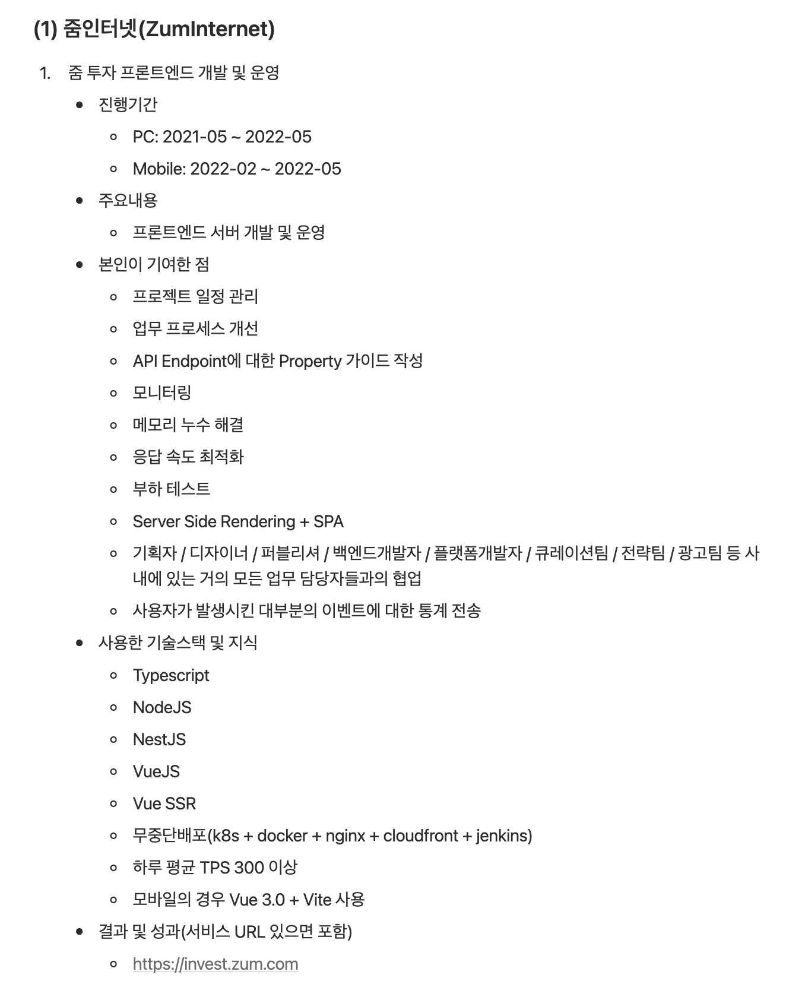
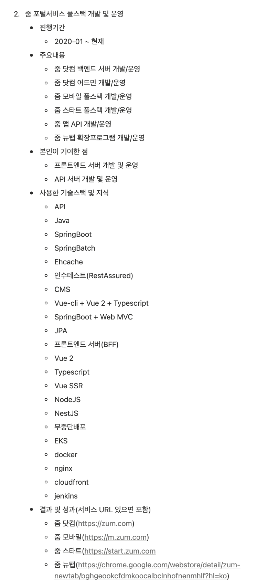
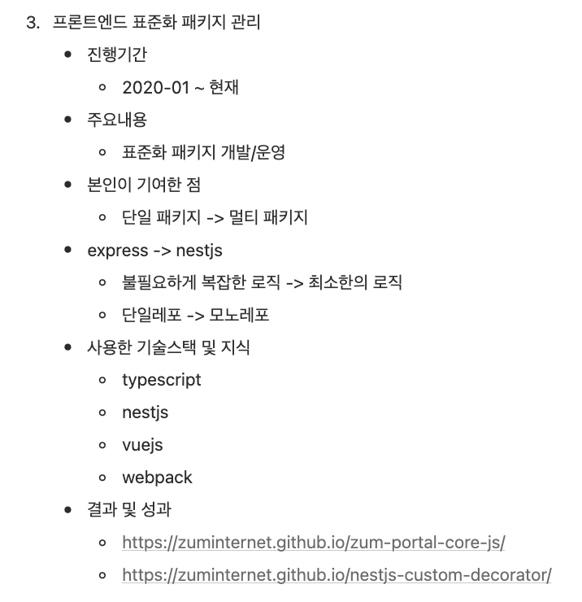
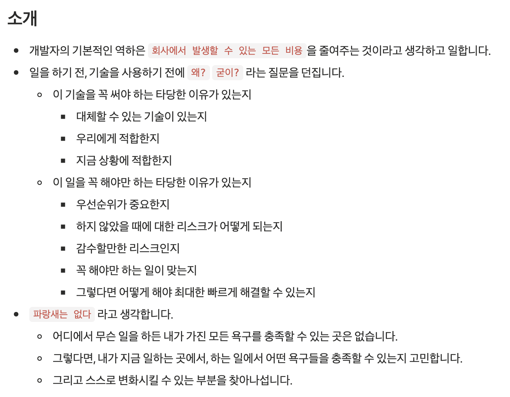
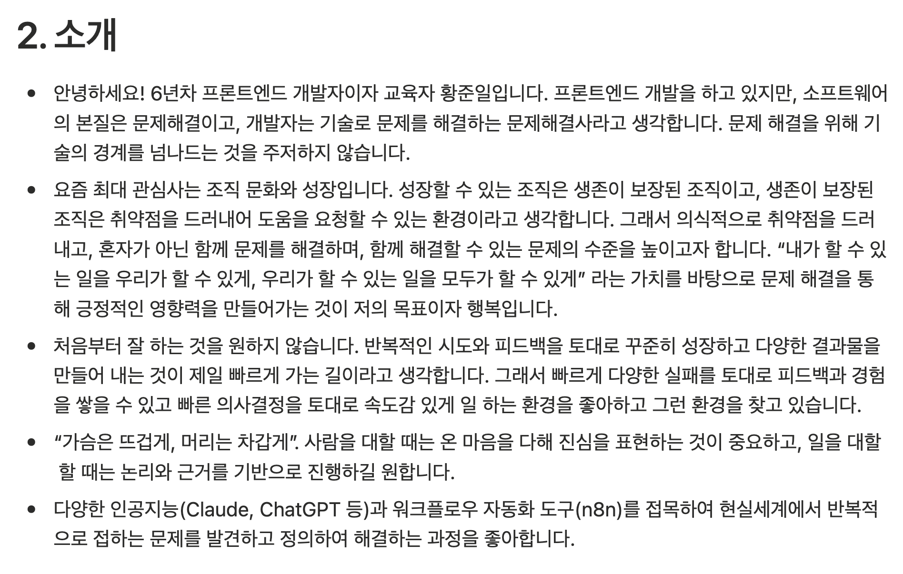
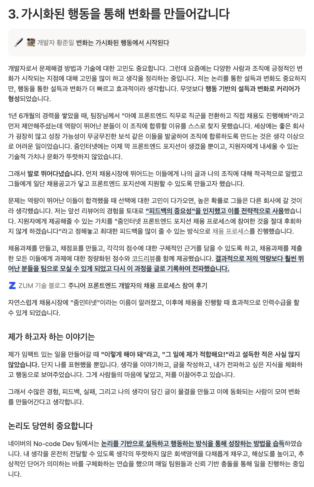
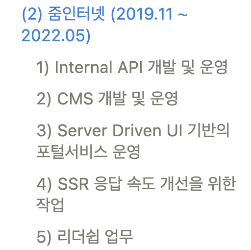
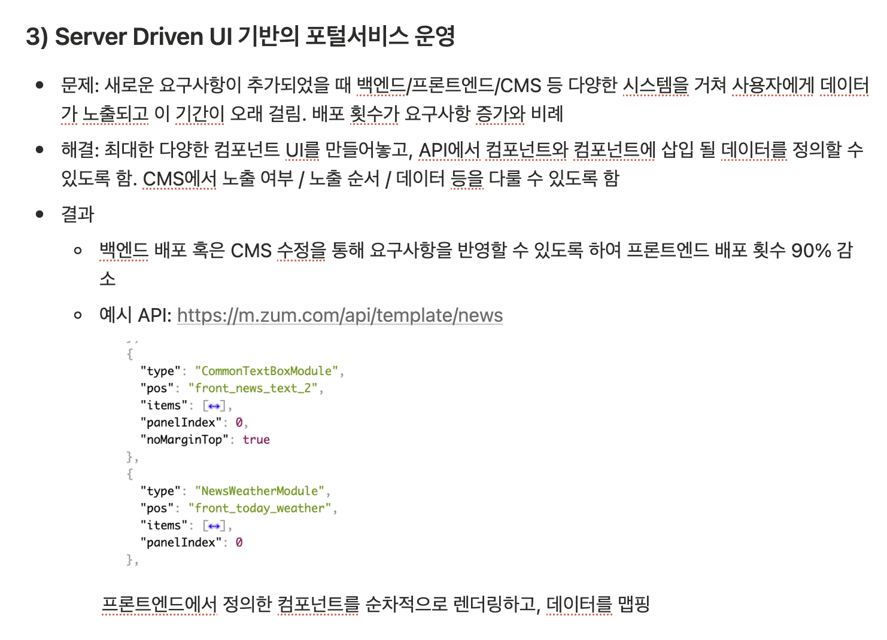
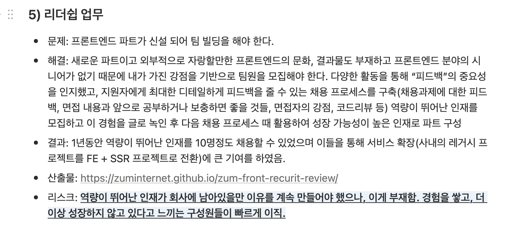

---

title: 이력서, 어떻게 작성해야 좋을까?
description: 이력서는 엔지니어링 관점에서 생각하면 일종의 나에 대한 공식문서이지 않을까?
date: 2026-11-08
tag: 커리어
thumbnail: https://raw.githubusercontent.com/JunilHwang/TIL/refs/heads/master/career/how-to-write-a-resume/assets/thumbnail.jpeg

---

# 이력서, 어떻게 작성해야 좋을까?

## 배경

요즘 사내추천 덕분에 많은 분들의 이력서를 접했고, 이 과정에서 꽤 많은 인사이트를 얻을 수 있었다. 사실 작년까지 멘토링을 통해 이력서 작성 방법에 대해 꽤 많은 이야기를 했는데 이에 대해 정리한적이 없어서 한 번 정리해보려고 한다.

## 나를 설명하는 문서

이력서는 엔지니어링 관점에서 생각하면 일종의 나에 대한 공식문서이지 않을까? 

기술문서는 보통 이 기술에 대한 소개, 목적, 다른 기술과 비교했을 때의 장단점, 강점, 사용방법, 기여방법 등을 제공한다. “기술”을 “사람”으로 바꾸면 이력서와 비슷하다고 생각한다.

나에 대한 소개, 나의 목적/목표, 장단점과 강점, 사용방법(어떤 역량이 있고, 나를 어떤식으로 활용하면 될지 등), 효과 등 나에 대한 설명서를 작성하는 것에 가깝고 이를 토대로 “어떤 문제를 얼마나 잘 해결할 수 있는가”를 조직에서 판단하는게 아닐까?

어쨌든 중요한건 결국 다른 이들에게 “나를 효과적이고 정확하게 설명하는 것” 이다. 너무 과장하면 안 되겠지만, 또 너무 나에대해서 모르면 나에 대해 설명하기가 쉽지 않다.

## 예제를 통해 비교해보기

아무래도 예제가 있어야 와닿을 것 같아서, 필자가 2022년도에 작성한 이력서와 2025년도에 작성한 이력서를 통해 비교해보고자 한다.

### AS-IS(2022)

[link-preview: https://junilhwang.notion.site/ver-2022-1a0514bc46548021880ac0ef588639a2?pvs=74]

줌인터넷 재직 시절 작성한 이력서를 보면 ~~진짜 개판~~이다.

  
  
  

이력서를 작성할 당시에, 이직을 해본적이 없기 때문에 어떤식으로 이력서를 작성해야 좋은지에 대한 생각을 아예 안 했었다. 이것저것 했던 것들은 많은데, 이걸 효과적으로 어필하는 게 미숙했다. 코드를 작성하는 것과 비슷하다. 유사한 내용이 많고, 이력에 대한 응집이 안 되어있고, 어떤 의도로 무엇을 설명하고자 했는지를 전혀 생각하지 않았다. 그냥 읽는 사람이 알아서 해석해주겠지 하는 마음이었달까. ~~솔직히 이력서 작성하기가 너무 귀찮았던 것 같다.~~

그래서 이 이력서의 문제점이 뭘까? 하나씩 뜯어보자.

#### 1) 중복 표현

- “프론트엔드 서버 개발 및 운영” 혹은 “개발 및 운영”, “개발/운영” 등의 표현이 반복되고 있다.
- 기술스택도 중복된다. 특히 “줌 포털서비스 풀스택 개발 및 운영” 쪽은 불필요하게 기술스택을 많이 나열하고 있다.

#### 2) “A를 했음” 위주의 표현이 많고 목적/임팩트/러닝포인트 등이 없다.

가령, “프론트엔드 표준화 패키지 관리” 에 대한 부분을 보면 이게 왜 필요했는지, 어떤 의사 결정 과정이 있었는지, 어떤 효과가 있었는지에 대한 내용이 아예 없다.

#### 3) “당연한” 내용이 담겨있다.

- 최상단에 있는 소개쪽에 작성한 내용이 그렇다. 어떻게보면 개발자로서 갖춰야할 기본적인 소양이고, 이런 내용을 작성 했을 때 읽는 입장에서는 큰 임팩트가 없다고 생각한다.
- `불필요하게 복잡한 로직 -> 최소한의 로직` , `프로젝트 일정정관리` , `기획자, 디자이너, 백엔드 개발자 등과 협업` `모니터링` `사용자가 발생시킨 이벤트에 대한 통계 전송` 등의 표현도 당연한 내용에 가깝다.
- 유사하게 많은 사람들이 이력서에 담는 내용은 “CRUD” 같은 것들이다. 당연히 해야 하는 것들에 대해서는 이력서에 굳이 담지 않아도 무방하다고 생각한다.

#### 4) “무엇을 더 잘 하는 사람”인지에 대한 내용이 없다.

- 이게 제일 중요한 부분이라고 생각한다. 이력서만 봤을 땐 무엇에 강점을 가지고 있는 사람인지 알기가 꽤 어렵다. 어떤 문제를 더 잘 해결할 수 있는지, 어떤 문제에 더 관심을 가지고 살펴보는 편인지 등이 없다. 즉, 이력서를 봤을 때 “이 사람과 어떤 일을 함께해야 우리 조직의 문제를 잘 풀어갈 수 있을까?” 에 대한 의문이 생긴다.
- 나의 직군에 대해서도 나만의 전문성 혹은 관심사가 필요하다. 기본기 외에 “더 잘 할 수 있는 일”을 구체화 하여 보여줄 수 있어야 한다.

::: tip 돌이켜 생각해보면
나는 이 이력서를 작성할 당시에 **이력서보단 아티클을 더 중요하게 생각했다.**
어차피 나에 대한 내용은 이력서를 통해 다 표현할 수 없다고 생각했고, 나에 대해 궁금한게 많다면 결국 블로그 아티클을 참고하겠거니 싶었다.
실제로 이직 준비할 당시에 블로그 아티클을 보고 연락을 주신 분들도 많았다.
그러다보니 이력서를 중요하게 생각하지 않았고, 형식적으로 작성하는 것이라고 생각했었다.
:::

### TO-BE(2025)

[link-preview: https://junilhwang.notion.site/20250916-270514bc46548012b28befac880862ad?pvs=74]

네이버 재직시절 작성한 이력서이긴 하지만 네이버의 이력 말고 줌인터넷의 이력을 어떤식으로 개선했는지 살펴보자.

#### 1) 소개를 할 때에는 “당연한 내용” 보다 “나만의 뚜렷한 가치관”을 담아보기.

- 무엇에 관심을 가지고 있는지, 어떤 가치관을 가지고 있는지, 어떤 전략을 가지고 있는지 등 “개발자” 로서의 모습도 중요하지만 결국 “황준일” 이라는 사람을 어떤식으로 표현하는지가 중요하다.
- 돌이켜 생각해보면 “<u>**개발자**</u> 황준일” 에서 “개발자 <u>**황준일**</u>” 표현의 포커스가 바뀐 것 같다. 나는 개발자이지만, 개발이라는 것도 조직이 가지고 있는 문제를 기술적으로 풀어나가는 것이고 핵심은 “문제 해결”이라는 것.
- 문제 해결은 기술적인 방식도 있지만 비기술적인 방식도 무척 많이 있으며 이 또한 강조할 수 있는 능력이고 역량이다.

#### 2) 이력서를 작성할 당시에 깊이 있게 고민하던 문제에 대해 다뤄보기

- 꼭 기술적인 내용이 아니어도 상관 없다. 중요한건 “고민의 깊이”라고 생각한다. 깊이 있게 고민이 있다면 어떤식으로든 이력서에 잘 담아보면 좋다.
- 이력서를 작성할 당시에 “변화” 라는 키워드에 꽂혀있었다. 변화는 어떻게 시작되는지, 어떤 전략을 가지고 행동해야 하는지 등. 그래서 길지만 최대한 솔직하지만 내용을 압축해서 다뤘다. 이게 상대방이 나를 깊이있게 이해하는 데 도움이 된다고 생각했다.

#### 3) 역량과 문제해결의 종류를 토대로 카테고라이징 (중복제거)

- 이력서를 통해 보여주어야 하는 것은 **내가 어떤 종류의 문제를 풀이했고, 잘 풀이할 수 있는 지** 라고 생각한다. 프로젝트는 이를 표현하기 위한 수단이다.
- 그래서 아예 프로젝트 단위가 아니라 **문제해결의 종류**를 토대로 카테고라이징 하여 풀어나가는 게 더 효과적이라고 생각한다.

#### 4) “왜 필요했는지”를 명시하기

- 단순하게 “무엇을 했음” 을 언급하는 것 보다, “A라는 이유가 있었고, B를 통해 해결했음”  의 흐름으로 작성해야 이해하기가 조금 더 수월하다.
- 성과 혹은 임팩트가 있으면 좋지만, 이게 없다면 “배운점” 혹은 “결과”, “산출물” 같은 것들이 있으면 좋다. 성과는 환경이 꽤 중요하기 때문에, 성과를 만들 수 있는 역량이 있음을 보여주는 게 중요하다.

#### 5) 소프트스킬도 중요하다.

- 꼭 팀의 리더를 하는게 아니라도, **리더쉽을 발휘할 수 있는 상황**이 분명 있다. 작은 프로젝트를 리딩하거나 혹은 프로젝트를 능동적으로 이끌어가는 것도 리더쉽이다. 이를 캐치하여 역량과 연결짓는 것이 중요하다.
- **일을 잘 하기 위한 문제정의**, **문제의 구조화** 등 본질을 잘 다루는 게 중요하다.

## 정리하자면

1. 나의 특장점이 보여야 한다. “무엇이든 잘 할 수 있음” 보단 “특히 이런 것들을 잘 할 수 있음” 을 보여주어야 한다.
2. 내가 팀장이라고 생각하고, 나에게 어떤 일을 시켰을 때 제일 임팩트가 있을지 상상해보자.
3. 깊게 고민한 것들을 잘 풀어낼 수 있어야 한다.
4. 이력이 역량 단위로 카테고라이징 되어야 한다.
5. 나의 강점에 대해 명확하게 설명할 수 있어야 한다.

## One more thing

이력서를 작성하는건 쉽지 않다. 나에 대해서 내가 잘 알아야 하고, 나의 강점과 역량을 캐치해서 표현해야 한다.
나는 이력서의 핵심이 <u>**“나에 대해 잘 이해하는 것”**</u> 이라고 생각한다.
**내가 나에 대해 잘 이해하기 위해 시도하는 것은 “글쓰기”이다.**
일기가 될 수도 있고, 회고가 될 수도 있다.
꼭 남에게 보여주지 않아도 괜찮다.

회사생활에 대해 써보는 것도 좋고, 일상에서 겪는 일들에 대해 써보는 것도 좋다.
무엇이 되었든 나에 대해서 쓰다 보면 나를 더 잘 이해할 수 있게 되고, 나를 표현하는 것이 자연스러워지는 시점이 분명 있을 것이다.

**이력서 작성과 면접의 본질은 “나를 표현하는 것” 이다.**
나에 대해 잘 이해할 수 있다면 나를 표현하는 것도 자연스러워지지 않을까?
그리고 이게 자연스러울 때 **더 어렵고 난해한 문제를 풀이할 수 있으리라 생각**한다.

## Reference

- [이력서 주도 경력 개발](https://blog.shiren.dev/ko/post/2025-02-28)
- [인프랩 CTO 이동욱님의 이력서](https://jojoldu.github.io/)
- [내 커리어를 위한 업무 이력 관리](https://the-next-web-research-lab.github.io/fe-dev/self-management/project-history.html)
