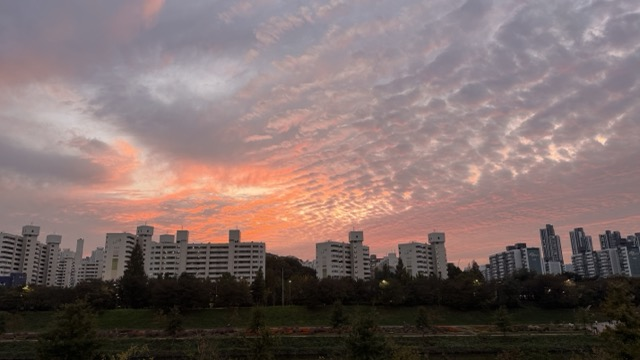

---

title: 욕심을 버리자
description: 욕심을 버리자. 다 잘 하고 싶은 욕심을 버리자. 한 가지만 잘 해도 된다. 아니, 한 가지라도 일단 잘 해야 한다.
date: 2026-10-25
tag: 생각
thumbnail: https://private-user-images.githubusercontent.com/18749057/683650556-381eef78-0790-4074-a427-3800bb9609d5.jpeg?jwt=eyJ0eXAiOiJKV1QiLCJhbGciOiJIUzI1NiJ9.eyJpc3MiOiJnaXRodWIuY29tIiwiYXVkIjoicmF3LmdpdGh1YnVzZXJjb250ZW50LmNvbSIsImtleSI6ImtleTUiLCJleHAiOjE3OTI4NTYxOTYsIm5iZiI6MTc5Mjg1NTg5NiwicGF0aCI6Ii8xODc0OTA1Ny82ODM2NTA1NTYtMzgxZWVmNzgtMDc5MC00MDc0LWE0MjctMzgwMGJiOTYwOWQ1LmpwZWc_WC1BbXotQWxnb3JpdGhtPUFXUzQtSE1BQy1TSEEyNTYmWC1BbXotQ3JlZGVudGlhbD1BS0lBVkNPRFlMU0E1M1BRSzRaQSUyRjIwMjYxMDI0JTJGdXMtZWFzdC0xJTJGczMlMkZhd3M0X3JlcXVlc3QmWC1BbXotRGF0ZT0yMDI2MTAyNFQxNTMxMzZaJlgtQW16LUV4cGlyZXM9MzAwJlgtQW16LVNpZ25hdHVyZT02YzhmMTY4ODZmMTE0ZDViMjQ3MDhlMzE5ODNjY2Q0MDY2YjhlMDRlYzhiNzQyNjZiNzBjY2ExODhkZjFmODk2JlgtQW16LVNpZ25lZEhlYWRlcnM9aG9zdCZyZXNwb25zZS1jb250ZW50LXR5cGU9aW1hZ2UlMkZqcGVnIn0.cte-H4BJGcgsjeZPNDJS5Z5I-UNJRhfcl5ixz5k_z5M

---

# 욕심을 버리자

요즘 다양한 고민을 참 많이 하고 있다.
세상이 변화하는 속도가 내 생각보다 훨씬 빠르고, 변화의 속도는 따라가기가 점점 벅차고, AI(혹은 유튜브나 인스타) 때문에 도파민에 절여지면서 점점 멍청해지는 중이다.
그런데 연차가 쌓일수록 해결해야 하는 문제의 난이도는 높아진다.
어떻게 살아야 좋을까? 어떤 태도를 가져야 좋을까?

일은 본의아니게 젊을 때 시작했다.
대학교 졸업 전에는 고등학교에서 강사로 일을 하기도 했고, 프리랜서로 웹사이트를 만들기도 하고, 군대 전역 후에 취업했던 디자인 에이전시 회사에서도 그누보드/워드프레스 기반의 웹 페이지를 다수 만들었다.
그러다 대학교 막학기에 줌인터넷(현 이스트에이드)에 취업하여 2년 6개월, 이후 네이버에서 3년 6개월, 그리고 현재 토스 플레이스에 입사한지 9개월 정도?

여튼 이제 7년차 개발자가 되었다(대학교 재학시절 일했던 기간까지 포함하면 9년차라고 할 수 있으려나?).
근데 그게 꽤 부끄럽다.
아무리 생각해도 나는 7년차의 역량을 갖추지 못했다고 생각한다.

특정 연차의 역량이라는 게 딱 맞게 정해져있지는 않겠지만, 내가 생각하기에 7년차는 “정답이 뚜렷하지 않은 기술적 문제를 추상화할 수 있는 역량”을 갖추어야 한다고 생각한다.

내 커리어를 돌아보면 나는 대체로 “선배 개발자가 만들어놓은 설계 혹은 환경” 위에서 작업을 진행했다.
줌인터넷에 있을 때에도, 선배 개발자가 설계한 틀을 그게 벗어나지 않은 형태로 개발을 진행했고, 네이버에 있을 때에도 설계의 세부사항은 채워나갔지만 큰 틀은 테크리드가 설계한 내용을 토대로 개발했다.
지금도 크게 다르지 않다고 생각한다.
이미 여러가지 역경과 실패를 통해 갖추어진 설계와 토대, 플랫폼 위에 무언가를 만드는 중이다.

나는 모방을 잘 한다.
이미 잘 갖추어진 환경을 확장하거나 이미 풀이된 문제에서 한 걸음 더 나아가는 것은 곧잘 하는 편이다.
다른 관점에서 보면, 나 스스로 모호하고 어려운 문제의 해결책을 찾아내는 것은 무척 어려워한다.
물론 그걸 쉽게 하는 사람은 흔치 않다.
하지만 그런 사람은 분명 존재한다.

저연차일 때에는 “오 나 좀 잘 하는 편이네?” 라고 생각했지만, 그 틀을 크게 벗어나지 못하는 중이다.
한계에 부딪혔달까?

사실 욕심이다.

대부분의 문제해결은 모방에서 시작한다.
이미 해결된 문제위에 무언가를 계속 덧붙이는 것이다.
이렇게도 시도해보고, 저렇게도 시도해보고, 계속 조물조물 하면서 교정하는 것이다.
지름길은 없다.

근데 요즘 계속 지름길을 계속 찾으려고 한다.
마음이 조급해진다.
나는 똑똑한 편도 아니고 창의적인 편도 아니고,  다재다능한 편도 아니다.
언제나 나는 내 한계를 명확히 알고 있다.
일단 “지금은” 못하는 것들이 꽤 많다.

그런데 시간이 흐르고, 경력이 쌓이고, 요구되는 역량이 많아질수록 마음이 조급해진다.
이것도 잘 해야 하고, 저것도 잘 해야 한다.
마주하게 되는 사람이 많아지고, 사람들의 빛나는 재능이 눈에 보인다.
나는 저렇게 하고 싶어도 잘 안 된다.
저 사람들이 부럽다.

이 또한 욕심이다.
내가 가지지 못한 것에 대해 부러워 해도 달라지는 것은 없다.
그냥 내가 할 수 있는 것을 해야한다.

그래서 나는 남들보다 시간을 많이 써야 된다.
무언가를 반복하다 보면 익숙해지고, 익숙해지면 편안해지고, 편안해진 상태가 되어야 제대로 생각할 수 있다.
코딩이라는 행위가 익숙해져야 코딩을 하면서 더 깊은 설계에 대해 생각할 수 있게 되는 것 처럼.
그리고 생각을 하다보면 무엇이 중요한지 본질이 무엇인지 조금씩 알아갈 수 있다.

나는 그런 사람이다.
조금 느린 사람.
연습을 많이 해야 되는 사람.
대신 체력이 좋은 편이고 성실한 편이다.
그냥 이렇게 살아왔기 때문에 체력이 좋아진걸까? 그건 잘 모르겠다.
어쨌든 지금은 그렇다.

그래서 내 커리어는 어떻게 쌓아가야 좋을까?

욕심을 버리자.
다 잘 하고 싶은 욕심을 버리자.
한 가지만 잘 해도 된다.
아니, 한 가지라도 일단 잘 해야 한다.

나는 크게 추상화 하는 능력이 약한 편이다.
그치만 작게 추상화 하는 능력은 나쁘지 않다고 생각한다.
작은 것들을 모으다보면 큰 것도 조금씩 만들 수 있다.
작은 단위의 코드를 개선하고, 그것들을 한 눈에 모아 보다가 큰 단위의 코드도 개선하다보면 “아키텍트” 의 영역에 조금이나마 도달할 수 있지 않을까?

좋은 설계는 잘 모르겠다.
해본적이 없으니까.
그치만 좋은 설계를 하고 싶다.
좋은 설계가 무엇인지 모르기 때문에 좋은 설계를 하는 것은 어렵다.
그래서 계속 경험해야 한다.
만들고 갈아 엎고, 만들고 갈아 엎는 행위를 계속 해봐야 한다.
지름길은 없다.

그래, 지름길은 없다.
그냥 한 걸음씩 나아가자.
쌓아가자.
그러다보면 도달할 수 있을 것이다.

아 그리고 기록하자.
발산하자.
그게 나의 확실하고 안전한 자산이 될 것이다.

  
  

